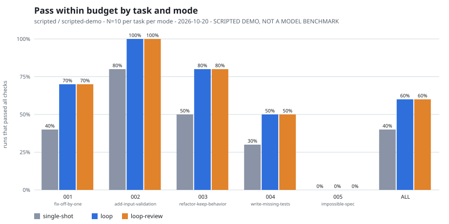
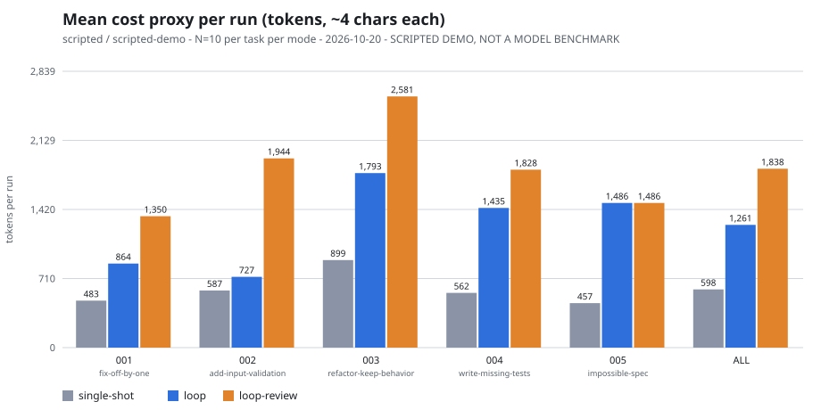

# lesson-agent-feedback-loop

**Question:** does an AI coding loop get better when objective checks, not model confidence, decide when it is done - and where does it not?

**Outcome:** a small, stdlib-only Python harness you can run in minutes to measure single-shot vs loop vs loop-with-separate-reviewer on five tiny tasks, see the safeguards (budgets, stop conditions, protected tests) in action, and repeat the experiment with your own model.

> This is a **teaching experiment, not a benchmark**. The committed results come from a **scripted provider** (canned replies, seeded scenario choice). They show how the harness measures a loop, not how any model performs.

Companion to the post *Stop Prompting AI. Start Engineering the Loop* (`posts/stop-prompting-ai-start-engineering-the-loop.md`). Read the story: [Notes on Loop Engineering](https://medium.com/@benceroth/notes-on-loop-engineering-e5a47db3429b). Safety around agent loops is covered in the sibling repo [`lesson-agent-harness`](https://github.com/benceroth/lesson-agent-harness).

## Quick start

Requires Python 3.12+ and `pytest` (`pip install -r requirements-dev.txt`). Nothing else.

```text
python -m loop validate-tasks            # starters fail, every scripted scenario ends as declared
python -m loop guard-demo                # a cheating attempt, with the guard on and off
python -m loop run 001 --scenario needs-visible-feedback --mode loop
python -m loop experiment --runs 10      # all tasks x 3 modes, scripted provider (~6 min on Windows)
python -m loop verify-results            # re-run the committed experiment and compare
python -m pytest                         # tests for the lab itself
```

Global options (`--tasks-dir`, `--work-root`) go before the subcommand. Scratch workspaces live in `runs/` (git-ignored).

## What the loop does

```text
builder proposes files -> guard (allow-list, diff scope) -> apply -> checks
   -> [separate reviewer, read-only] -> structured feedback -> retry
stop on: passed | max_attempts | max_seconds | max_tokens | stalled | provider_error | guard_violation
```

- **Checks decide.** Visible tests, hidden tests (reported by name only), mutation checks (task 004) and optional ruff/mypy adapters. Builder confidence is never an input.
- **Budgets and stop conditions.** Attempts, wall time, a token proxy (~4 chars/token) and stall detection (two attempts without strictly fewer failures). A stop ends with an escalation message, not a claimed success.
- **Separate reviewer.** A different provider instance with its own prompt (`templates/review-prompt.md`). It sees the diff and check summary, not the builder's reasoning, cannot edit, and blocking findings without evidence are demoted.
- **Reward-hacking guard.** Only allow-listed paths are editable; tests, config and hidden checks are protected. `guard-demo` shows the same cheater (1) blocked, (2) caught only by hidden tests when the guard is off, (3) **falsely passing** when both are off.

## Tasks

| Task | What it shows |
|---|---|
| 001 fix off-by-one | feedback from visible and hidden tests helps |
| 002 add input validation | passes its tests but misses a case only a ground-truth **audit** sees (false confidence); a separate reviewer can catch it |
| 003 refactor keep behavior | a loop that never converges ends at the attempt budget |
| 004 write missing tests | success judged by mutation checks, not by "tests pass" |
| 005 impossible spec | contradictory requirements: the correct outcome is escalation, never success |

## Example results (scripted demo, N=10, seed 20261020)

Whole-suite rows; full table in [`experiments/results/summary.md`](experiments/results/summary.md).

| Mode | pass@1 | pass within budget | tokens / success (proxy) | false confidence |
|---|---:|---:|---:|---:|
| single-shot | 40% | 40% | 1494 | 3 |
| loop | 40% | 60% | 2101 | 3 |
| loop-review | 34% | 60% | 3063 | 0 |




These numbers are a function of the canned scenarios. They demonstrate the measurements (pass@1, pass within budget, cost per success, false confidence, stall counts), not model quality. Protocol for real runs: [`experiments/single-shot-vs-loop.md`](experiments/single-shot-vs-loop.md).

## Use a real model (optional)

```text
set LOOP_API_KEY=...            # never commit keys
set LOOP_MODEL=your-model
set LOOP_BASE_URL=https://api.openai.com/v1   # any /chat/completions server; http only for localhost
python -m loop run 001 --provider openai --mode loop
```

Prompts contain task code and generated code is executed locally; read [SECURITY.md](SECURITY.md) and `docs/safeguards.md` first.

## Known limits

- Scripted results are not evidence about models; real-model results vary by model, date and prompt, and small N is noise.
- Tasks are tiny and Python-only; the hidden checks are mine, so "pass" means "passes these checks".
- Token counts are a proxy. Wall-clock times in the CSV are machine-dependent.
- No sandbox: generated code runs in a subprocess with your privileges. Use a container for untrusted models.

## Layout

```text
loop/          runner, budget, guard, reviewer, checks/, providers/, metrics, chart, cli
tasks/         001..005: BRIEF.md, task.json, starter/, hidden/, scripted.py
templates/     review-prompt.md, task-brief.md, AGENTS.md
docs/          when-loops-fail.md, safeguards.md
experiments/   single-shot-vs-loop.md, results/ (committed scripted demo)
tests/         tests for the lab itself
```

## License

MIT - see [LICENSE](LICENSE).

<sub>[Bence Roth](https://broth.hu/)</sub>
